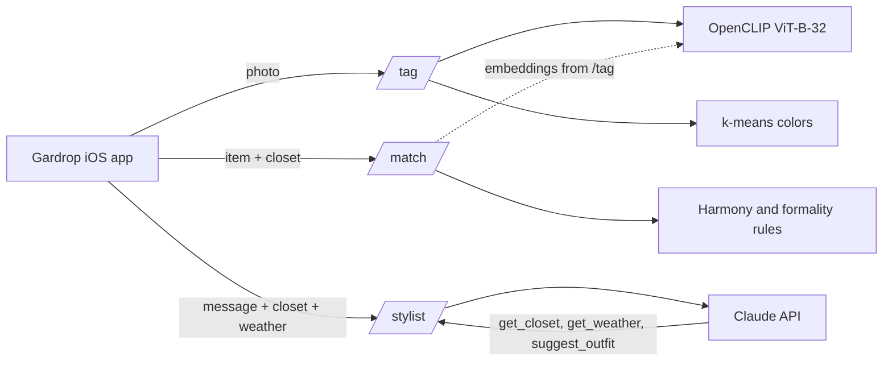

# Gardrop AI

The AI service behind **Gardrop**, a native iOS wardrobe app that suggests outfits for today's weather.

It looks at a photo of a piece of clothing and tells you what it is, checks whether a new piece will work with the clothes you already own, and runs a personal stylist you can chat with.

**Stack:** Python 3.12 · FastAPI · OpenCLIP (ViT-B-32) · scikit-learn · Claude API · pytest · Docker · GitHub Actions

## Features

| Endpoint | What it does | How |
|---|---|---|
| `POST /tag` | Category, pattern, season, formality and main colors from a photo | CLIP zero-shot classification + k-means on garment pixels |
| `POST /match` | "Will this go with my closet?" Score, outfit count, best pairings, duplicates | Explainable rules: color harmony, formality, pattern + CLIP similarity |
| `POST /stylist` | Chat: *"What should I wear to a wedding on Saturday?"* | Claude with tool use: reads the closet and weather, returns outfit cards |
| `GET /health` | Liveness, stylist and model status | No API key required |

Open [http://127.0.0.1:8000/docs](http://127.0.0.1:8000/docs) to try every endpoint in the browser.

## Architecture



### How tagging works

CLIP maps images and sentences into the same vector space. To classify a photo, the service compares its vector with short descriptions like *"a photo of jeans"* or *"a striped garment"* and picks the closest. No training data is needed, and a new label is one line of text in `app/services/tagging.py`.

Colors come from k-means clustering on the garment's pixels only: transparent pixels of a cut-out PNG, or pixels close to the photo's background color, are ignored first.

The returned `embedding` is meant to be stored by the iOS app and sent back to `/match`.

**Labels**

- Category: `top`, `bottom`, `outerwear`, `shoes`, `dress`
- Pattern: `solid`, `striped`, `plaid`, `floral`, `dotted`, `graphic`
- Season: `summer`, `winter`, `all-season`
- Formality: `sporty`, `casual`, `smart-casual`, `formal`

### How matching works

Every pair of pieces gets a 0–1 score: color harmony 50% (neutrals go with everything, analogous and complementary hues work), formality 30%, pattern 20% (two patterns together score low). Big formality gaps, like a hoodie with oxford shoes, always fail.

The service then counts how many complete outfits the new piece creates and flags near-duplicates using CLIP embeddings. Every result comes with plain-language reasons.

The overall score is 0–100. Verdict: `great` (≥70), `good` (≥45), `hard`.

### How the stylist works

Claude never sees the whole closet up front. It calls tools the service runs:

- `get_closet` — optionally filtered by category
- `get_weather` — the weather the client sent
- `suggest_outfit` — an outfit card the app can render (at most 3)

The service rejects ids that aren't in the closet, so the stylist can't invent clothes. Without `ANTHROPIC_API_KEY`, the endpoint returns `503`.

## Run locally

Requires [uv](https://docs.astral.sh/uv/).

```bash
uv sync
cp .env.example .env
uv run uvicorn app.main:app --reload
```

The first `/tag` call downloads the CLIP model (about 600 MB).

### Environment variables

| Variable | Required | Description |
|---|---|---|
| `ANTHROPIC_API_KEY` | for `/stylist` | From the [Anthropic Console](https://console.anthropic.com) |
| `SERVICE_API_KEY` | recommended in production | When set, every request except `/health` must send `X-API-Key` |
| `STYLIST_MODEL` | no | Default: `claude-haiku-5-5` |
| `MAX_UPLOAD_MB` | no | Default: `10` |
| `CLIP_MODEL` / `CLIP_PRETRAINED` | no | Default: `ViT-B-32` / `laion2b_s34b_b79k` |

## Example requests

```bash
# health
curl http://127.0.0.1:8000/health

# tagging
curl -F "file=@jeans.jpg" http://127.0.0.1:8000/tag

# when an API key is configured
curl -H "X-API-Key: $SERVICE_API_KEY" -F "file=@jeans.jpg" http://127.0.0.1:8000/tag
```

`/match` body (abridged):

```json
{
  "item": {
    "id": "new-1",
    "name": "Camel coat",
    "category": "outerwear",
    "colors": ["C4A27A"],
    "pattern": "solid",
    "formality": "smart-casual"
  },
  "closet": []
}
```

`/stylist` body (abridged):

```json
{
  "message": "What should I wear to the office today?",
  "history": [],
  "closet": [],
  "weather": { "city": "Istanbul", "temperature": 12, "condition": "rainy" }
}
```

## Tests

Tests replace CLIP and Claude with small fakes, so they run in under a second, offline, without an API key.

```bash
uv run pytest
uv run ruff check .
```

CI (`.github/workflows/ci.yml`) runs ruff and pytest on `main` and pull requests.

## Evaluation

See [`eval/README.md`](eval/README.md). The script measures tagging accuracy on your own labeled photos and writes a confusion matrix to `eval/results.md`.

```bash
uv run python -m eval.evaluate
```

| Attribute | Accuracy | Photos |
|---|---|---|
| category | _run the eval_ | |
| pattern | _run the eval_ | |
| formality | _run the eval_ | |

## Deploy (Docker / Hugging Face Spaces)

The Dockerfile downloads CLIP during the build and serves on port **7860** (what Spaces expects).

```bash
docker build -t gardrop-ai .
docker run -p 7860:7860 --env-file .env gardrop-ai
```

On Spaces:

1. Create a new Space with the **Docker** SDK.
2. Push this repository to it.
3. In the Space settings, add `ANTHROPIC_API_KEY` and `SERVICE_API_KEY` as secrets.

## Project structure

```
app/
├── main.py            FastAPI app and routers
├── config.py          Settings from environment variables
├── schemas.py         Request and response models
├── security.py        Optional X-API-Key check
├── routers/           One file per endpoint
└── services/
    ├── embedder.py    CLIP wrapper (lazy loaded)
    ├── tagging.py     Zero-shot labels
    ├── colors.py      k-means colors and color harmony
    ├── matching.py    Closet matching rules
    └── stylist.py     Claude tool-use loop
eval/                  Accuracy benchmark
tests/                 pytest suite with fake CLIP and Claude
```
