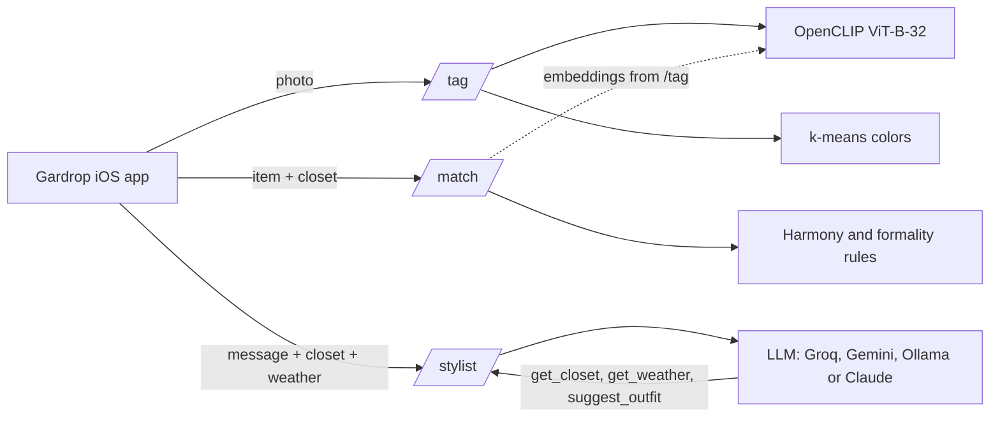

# Gardrop AI

**The AI service behind Gardrop, a wardrobe app that tells you what to wear today.**

Send it a photo of a piece of clothing and it tells you what it is. Ask it whether a new piece will work with the clothes you already own. Or just chat with it: *"I'm going out with friends tonight, what should I wear?"*

[](https://github.com/tunabsdrmz/gardrop-ai/actions/workflows/ci.yml)


**Stack:** Python 3.12 · FastAPI · OpenCLIP · scikit-learn · LLM tool use (Groq, Gemini, Ollama or Claude) · pytest · Docker · GitHub Actions

---

## What it does

| Endpoint | Question it answers | How |
|---|---|---|
| `POST /tag` | *What is this?* Category, pattern, season, formality and main colors | CLIP zero-shot classification + k-means on the garment's pixels |
| `POST /match` | *Should I buy it?* A 0–100 score, outfits it creates, best pairings, duplicates | Explainable rules: color harmony, formality, pattern + CLIP similarity |
| `POST /stylist` | *What should I wear?* A short answer plus outfit cards | An LLM with tool use that reads your closet and the weather |
| `GET /health` | Is it up, which LLM is configured, is CLIP loaded | |

## Examples

Real responses from a local run.

### `/tag`: a photo of a light blue T-shirt

```json
{
  "category":  { "label": "top",    "confidence": 0.977 },
  "pattern":   { "label": "solid",  "confidence": 0.988 },
  "season":    { "label": "summer", "confidence": 0.979 },
  "formality": { "label": "sporty", "confidence": 0.69 },
  "colors": [
    { "hex": "88A9BC", "name": "light blue", "ratio": 0.574 }
  ],
  "embedding": [0.01846, -0.07088, "… 512 numbers"]
}
```

### `/stylist`: *"Bu akşam arkadaşlarla dışarı çıkacağım, ne giysem?"* (Ankara, 9°C, cloudy)

The stylist answers in the user's language and only suggests pieces from their closet.

```json
{
  "reply": "Bu akşam için şık bir smart-casual tercih ettim: beyaz keten gömlek, bej chino, lacivert ceket ve kahve botlar. Soğuk bulutlu havada rahat ve tarzı koruyacak bir kombin.",
  "outfits": [
    {
      "title": "Şık Akşam",
      "item_ids": ["shirt-1", "chino-1", "jacket-1", "boots-1"],
      "reason": "Akşam serinliğine uygun, smart-casual bir görünüm."
    }
  ]
}
```

### `/match`: a sporty T-shirt against a mostly smart-casual closet

```json
{
  "score": 44,
  "verdict": "hard",
  "outfit_count": 1,
  "best_pairings": [
    { "item_id": "jeans-1",    "name": "Black jeans",     "score": 0.925 },
    { "item_id": "sneakers-1", "name": "White sneakers",  "score": 0.925 }
  ],
  "similar_items": [],
  "reasons": ["Goes well with 2 of 6 matching pieces.", "Creates 1 complete outfit with what you own."]
}
```

## Architecture



The service is stateless: the app sends the closet with each request, so there is no database to run and no user data stored.

## How it works

### Tagging: zero-shot with CLIP

CLIP maps images and sentences into the same vector space. To classify a photo, the service embeds it once and compares it with a few short descriptions per label (*"a photo of jeans"*, *"a photo of trousers"*, …). The label whose averaged description vector is closest wins, and a softmax turns the similarities into confidences.

No training data is needed, and supporting a new label is one line of text in [`app/services/tagging.py`](app/services/tagging.py).

Colors come from k-means clustering on the garment's pixels only. Transparent pixels of a cut-out PNG, or pixels close to the photo's border color, are removed first. Clusters under 5% (buttons, zips) are ignored, and each color gets the nearest name from a small fashion palette.

### Matching: explainable rules

Every pair of pieces gets a 0–1 score:

| Factor | Weight | Rule |
|---|---|---|
| Color harmony | 50% | Neutrals go with everything; analogous and complementary hues work; the rest clash |
| Formality | 30% | Same level is best, one step apart is fine |
| Pattern | 20% | Two patterns together score low |

A formality gap of two or more levels always fails, whatever the colors: a hoodie never goes with oxford shoes. An outfit counts only if every pair in it passes. Near-duplicates are flagged with CLIP embedding similarity, so you don't buy the same white T-shirt twice.

### Stylist: tool use, any LLM

The model never sees the whole closet up front. It calls tools that the service runs:

- `get_closet(category?)`: the user's pieces
- `get_weather()`: today's weather
- `suggest_outfit(title, item_ids, reason)`: turns a recommendation into a card the app can render

The service rejects ids that aren't in the closet and sends the error back to the model, which then corrects itself. The model can't recommend clothes the user doesn't own. A turn limit caps cost.

The stylist is provider-agnostic. Pick one with `STYLIST_PROVIDER`:

| Provider | Cost | Default model | Good for |
|---|---|---|---|
| `groq` | Free tier | `openai/gpt-oss-120b` | Hosted demo, very fast |
| `gemini` | Free tier | `gemini-2.5-flash` | Hosted demo |
| `ollama` | Free, runs on your machine | `qwen2.5:7b` | Offline development |
| `anthropic` | Paid | `claude-haiku-5-5` | Best quality |

Groq, Gemini and Ollama share one code path through their OpenAI-compatible APIs. Claude uses its native tool-use format.

## Design decisions

- **Zero-shot instead of a trained classifier.** No labeled dataset to collect, new labels in one line, and a public model anyone can reproduce. The trade-off is accuracy on rare items, which the evaluation script measures.
- **Rules instead of ML for matching.** Every score comes with reasons a user can read. There's no data yet to learn taste from; once users rate outfits, those ratings can train a model that replaces the weights.
- **Validated tool calls instead of parsing text.** Outfits come back as structured data, and every id is checked server-side, so hallucinated clothes never reach the app.
- **Dependency injection everywhere.** CLIP and the LLM are FastAPI dependencies, so tests swap them for fakes and run offline in seconds.

## Known limitations

- **Photos of a person wearing the item.** `/tag` gets the category right, but the colors also include skin and other garments. The iOS app sends cut-out PNGs with the background removed, which avoids this. A future fix is to segment only the detected garment.
- **Rare or regional items.** CLIP knows what the internet has many photos of; *jeans* is easy, a *şalvar* is not.
- **Small local models.** With Ollama, 3B–7B models sometimes misuse tools. The service handles broken tool arguments gracefully, but hosted models give better answers.

## Evaluation

[`eval/`](eval/) measures tagging accuracy on your own labeled photos and writes a confusion matrix to `eval/results.md`.

| Attribute | Accuracy | Photos |
|---|---|---|
| category | _pending_ | |
| pattern | _pending_ | |
| formality | _pending_ | |

## Run locally

Requires [uv](https://docs.astral.sh/uv/).

```bash
git clone https://github.com/tunabsdrmz/gardrop-ai.git
cd gardrop-ai
uv sync
cp .env.example .env          # set STYLIST_PROVIDER and its API key
uv run uvicorn app.main:app --reload
```

Open http://127.0.0.1:8000/docs to try every endpoint in the browser. The first `/tag` call downloads the CLIP model (about 600 MB).

```bash
curl -F "file=@tshirt.jpg" http://127.0.0.1:8000/tag
```

A free Groq key is enough for the stylist: create one at [console.groq.com](https://console.groq.com), then set `STYLIST_PROVIDER=groq` and `GROQ_API_KEY` in `.env`.

## Tests

```bash
uv run pytest      # 30 tests
uv run ruff check .
```

CLIP and the LLMs are replaced with small fakes, so the suite runs offline, in seconds, without any API key. CI runs lint and tests on every push.

## Deploy

The Dockerfile downloads CLIP during the build and serves on port 7860, ready for [Hugging Face Spaces](https://huggingface.co/docs/hub/spaces-sdks-docker):

1. Create a Space with the **Docker** SDK and push this repository to it.
2. Add `STYLIST_PROVIDER`, its API key, and `SERVICE_API_KEY` as secrets.
3. Clients send `SERVICE_API_KEY` in the `X-API-Key` header. `/health` stays public.

## Project structure

```
app/
├── main.py            FastAPI app and routers
├── config.py          Settings from environment variables
├── schemas.py         Request and response models (Pydantic)
├── security.py        Optional X-API-Key check
├── routers/           One file per endpoint
└── services/
    ├── embedder.py    CLIP wrapper, loaded lazily
    ├── tagging.py     Zero-shot labels
    ├── colors.py      k-means colors and color harmony
    ├── matching.py    Closet matching rules
    └── stylist.py     Tool-use loop, one backend per LLM API
eval/                  Accuracy benchmark
tests/                 pytest suite with fake CLIP and LLMs
```

## Roadmap

- [ ] Connect to the Gardrop iOS app: tags when adding a piece, a stylist chat screen
- [ ] Segment the garment before extracting colors from photos of people
- [ ] Publish evaluation results on 50+ labeled photos
- [ ] Prefer warmer outerwear below 10°C in the stylist
- [ ] Stream stylist replies (server-sent events)

## License

MIT
